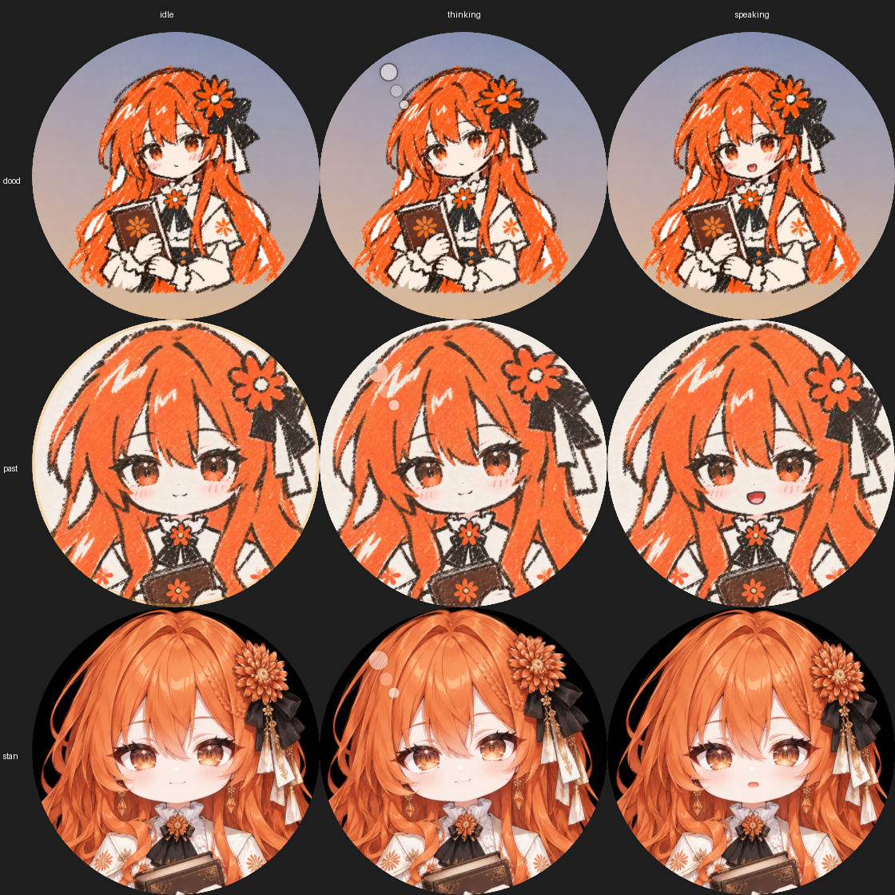

# bothouse-iot

bothouse 的硬件联网插件：把跑小智协议的 ESP32 圆屏板子接进 [bothouse](https://github.com/zuiho-kai/bothouse)，
让每块板子成为一个角色的「身体」——你对板子说话，话进到这个角色的 bot；bot 回话，板子念出来，表盘跟着变。

```
  ESP32 圆屏板 ──小智协议(OTA+WS)──▶ 设备服务 (server/) ──bridge 协议 WS──▶ bothouse ──▶ 角色的 bot
  (固件 firmware/)              收音切句、转文字、合成、    注册为外部平台
                                放音、表盘、固件升级        (text + audio)
```

bothouse 本体不用改：设备服务走 bothouse 现成的外部适配器接口（`[bridge]`），注册成一个能收发文字和音频的平台。

## 仓库里有什么

| 目录 | 内容 |
|---|---|
| `server/` | 设备服务 + bothouse 适配器（Python，aiohttp） |
| `firmware/` | 对上游 xiaozhi-esp32 v2.5.2 的补丁、表盘组件 cn_dial、编译脚本、刷写说明 |
| `tools/` | `board-nvs.py`（USB 改板子的服务器地址 / Wi-Fi / 钥匙）、`fake_board.py`（假板子）、`e2e.py`（对着隔离 bothouse 的端到端自检）、`cloud_sim.py`（云端模拟自检：本机模拟云端转发和隧道，不用真板子和服务器，CI 每次跑）、`dial_demo.py` / `dial_frames.py` / `skin/`（会动的表盘：预览、录圆屏帧、做皮肤） |
| `skins/` | 表盘角色皮肤：橘的「标准」「油画棒」「涂鸦」三款 |
| `docs/` | 接线说明、出门用（云端转发）、做表盘皮肤 |
| `deploy/remote/` | 云端转发的 nginx 段、反向隧道（launchd / systemd）示例 |

## 快速开始

```bash
cd server && uv venv && uv pip install -e '.[test]'
cp ../config.example.toml ../config.toml   # 写上板子 MAC、角色、bothouse 项目
BOTHOUSE_BRIDGE_TOKEN=... .venv/bin/python -m bothouse_iot --config ../config.toml
```

接线全过程（bothouse 侧配置、编固件、写板子 NVS、绑定）见 [docs/wiring.md](docs/wiring.md)。

## 功能

- 对板子说话，话进到绑定角色的 bot；bot 回话由板子念出来（语音默认交给 bothouse 转写和合成，没配时用本机命令）。
- 板子圆屏上的角色表盘：名字、头像，待机 / 思考中 / 正在回答跟着 bot 变。
- 网页表盘：浏览器打开 `http://<设备服务>:8791/dial`，没有板子也能看各角色在干什么；`/dial?role=<角色>` 只看一个。
- 会动的角色：待机时呼吸、头发轻摆、随机眨眼；思考时歪头、眼神上移、头边冒气泡；说话时嘴跟着语音的音量开合。
  一张立绘就能做，每个角色可以有几款皮肤（自带橘的「涂鸦」「油画棒」「标准」三款），网页 `/dial?skin=<皮肤>` 随时换着看；
  圆屏用同一套动画离线录好的循环帧按状态播，说话时只刷嘴那一小块。做法见 [docs/dial-skins.md](docs/dial-skins.md)，
  动画引擎来自 [Coopanion](https://github.com/Pal-AI-Lab/Coopanion)。

  橘的三款皮肤（从上到下：涂鸦、油画棒、标准；从左到右：待机、思考中、正在回答）：

  

- 出门也能用：板子连手机热点，经云服务器转发连回家里（[docs/remote.md](docs/remote.md)），每块板一把钥匙。
- 固件发布：打 tag 时 GitHub Actions 编好固件放到 Release；设备服务配 `firmware_release` 后自己取最新版，
  板子连上时比对，不一样就在空闲时 Wi-Fi 升级。不想自己编的直接下 Release 里的 `xiaozhi-<板型>.bin`。

## 路线图

- 真板实测：用真板从头走一遍「说话 → 念出来 → 表盘跟着变」，包括出门经云端；会动的表盘在板子上的帧率实测。
- 其他角色的两款皮肤（GPT、Opus、DeepSeek、Gemini 等主角色）。
- 几个角色轮流说话：同一时刻只有一个角色在说，人一开口就打断。
- 语音口令：喊角色名唤醒、说「暂停」打断、语音闭麦开麦。

## 许可

Apache-2.0。固件补丁基于 MIT 许可的 xiaozhi-esp32；表盘动画引擎 `server/bothouse_iot/static/vendor/coopanion/rig.js`
原样取自 Coopanion v0.2.18，带它自己的许可文件。见 [NOTICE](NOTICE)。
